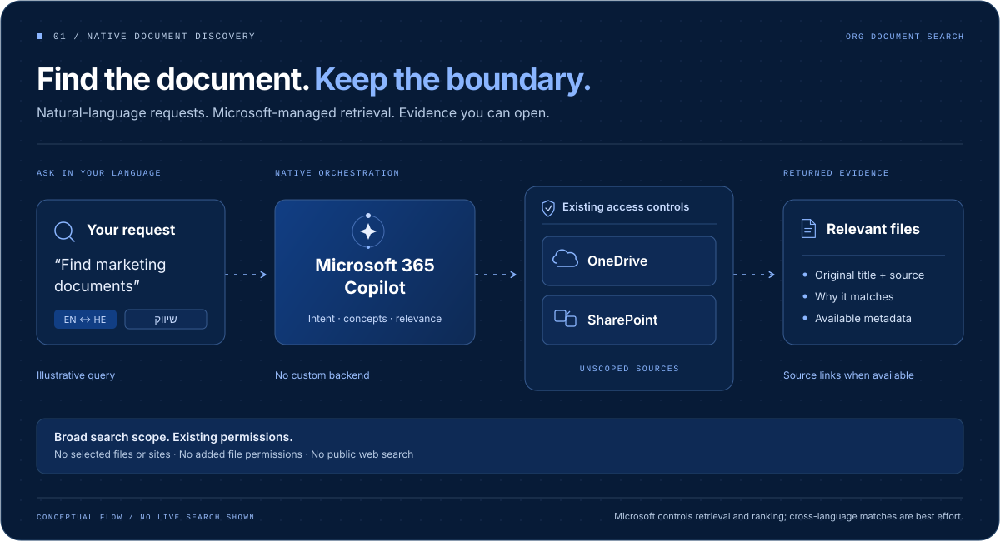
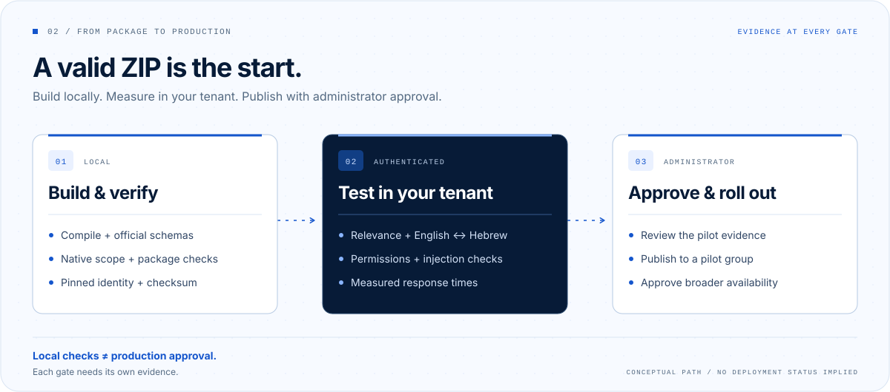

# Org Document Search

Find organizational documents in OneDrive and SharePoint using natural language, document content, and available metadata. The agent includes English/Hebrew discovery guidance, concise ranked results with source evidence, original document titles, and transparent handling of weak matches or retrieval errors.



This is a Microsoft 365 declarative agent using Microsoft-managed retrieval and orchestration. Its only native capability is:

```json
{ "name": "OneDriveAndSharePoint" }
```

There are no file, folder, or site restrictions in the manifest. Microsoft documents this configuration as broad OneDrive/SharePoint source access; existing user permissions and tenant discovery controls still apply. It does not grant access to every organizational file. [Manifest reference](https://learn.microsoft.com/en-us/microsoft-365/copilot/extensibility/declarative-agent-manifest-1.9#onedrive-and-sharepoint-object).

See [development documentation](docs/README.md) for the specification, architecture, discovery record, and architecture decision records.

## Scope and readiness

The runtime needs no custom backend, Azure resource, Graph application permission, ingestion pipeline, vector database, or external service. Web search and other capabilities are excluded. Microsoft controls retrieval execution and ranking; the instructions guide selection and presentation of returned evidence. Synonyms, multilingual discovery, metadata search, and semantic relevance are best effort, with no exhaustive-search guarantee.

Local schema, configuration, package, and synthetic tests are separate from actual search quality. **The implementation is not approved for production until the installing organization completes authenticated retrieval, cross-language, permission-isolation, performance, and administrator acceptance gates.** See [IMPLEMENTATION_REPORT.md](IMPLEMENTATION_REPORT.md) for observed local results and [TESTING.md](TESTING.md) for tenant evaluation.

## Prerequisites and licensing

- Git, Node.js 22.19.0 or later supported by the pinned dependencies, and npm. Node.js 24 is used for the local baseline. Use the committed lockfile.
- For tenant testing: a work/school Microsoft 365 account, SharePoint Online/OneDrive content accessible to that user, and permission to install or request custom agents under tenant policy.
- Use an active Microsoft 365 Copilot license for each baseline pilot user. Source availability does not remove Microsoft's subscription and service requirements.
- An authorized administrator must review organizational deployment and any applicable billing configuration.

Microsoft's general agent guidance discusses Copilot Chat metered consumption for organizational grounding. However, the current SharePoint/OneDrive knowledge-source note and known-issues page explicitly require an active Microsoft 365 Copilot user license and describe runtime failure without one. Treat metered-only operation for this particular agent as requiring confirmation and a successful pilot in your tenant; this repository does not guarantee it. Do not enable billing or buy licenses solely on the basis of a successful ZIP build. [Agent licensing scenarios](https://learn.microsoft.com/en-us/microsoft-365/copilot/agent-essentials/m365-agents-admin-guide), [source-specific requirements](https://learn.microsoft.com/en-us/microsoft-365/copilot/extensibility/knowledge-sources), [runtime license issue](https://learn.microsoft.com/en-us/microsoft-365/copilot/extensibility/known-issues).

## Clone and validate without a tenant



Clone the repository, then run these commands in its root:

```sh
git clone https://github.com/Tovli/ms-copilot-orgwide-search-agent.git
cd ms-copilot-orgwide-search-agent
npm ci --ignore-scripts
npm run build
npm run validate
npm test
npm run package
npm run verify-package
npm run secrets
npm audit --audit-level=moderate
```

`npm run check` combines the local build, validation, tests, packaging, package verification, and secret checks. Dependency audit remains a separate command. These commands do not authenticate, provision, install, or publish an agent. Dependency installation and audit use the package registry; runtime document retrieval stays in Microsoft 365.

TypeSpec is the authoring format: `src/agent/main.tsp` and `src/agent/prompts/instructions.tsp` emit the declarative-agent JSON. The pinned baseline is Microsoft 365 Agents Toolkit CLI **1.1.19**, Microsoft Copilot TypeSpec emitter **1.0.0**, and TypeSpec compiler **1.17.0**. The application template uses schema **1.30**. The stable emitter produces declarative-agent schema **1.5**; newer Microsoft documentation currently describes **1.9**, but this project retains the version actually supported by the selected emitter instead of relabeling its output. The implementation report records compatibility validation. Do not hand-edit compiled output or upgrade schema numbers independently of the emitter and tests.

Toolkit is a local development dependency, so no global install is necessary:

```sh
npm exec -- atk --version --telemetry false
npm exec -- atk list templates --telemetry false
```

The CLI's supported operations and flags are described in the [Microsoft 365 Agents Toolkit CLI reference](https://learn.microsoft.com/en-us/microsoftteams/platform/toolkit/microsoft-365-agents-toolkit-cli). Local pinned command help is the authority when older examples differ.

## Build artifacts and configuration

The default package is `dist/validation/org-document-search-0.1.0.zip`. It uses the synthetic configuration in `config/deployment.example.json` and is intended for tenant-free build checks. **Do not upload that validation artifact as an organizational release.**

For your installation, copy the example to ignored `local/deployment.json` and replace its app identity and publisher details:

```sh
node -e "const fs=require('node:fs');fs.mkdirSync('local',{recursive:true});fs.copyFileSync('config/deployment.example.json','local/deployment.json',{flag:'wx'})"
node -e "console.log(require('node:crypto').randomUUID())"
```

Generate a UUID only for a new installation. Keep the approved `appId` for every upgrade. Set `developer.name` (at most 32 characters) and the HTTPS `websiteUrl`, `privacyUrl`, and `termsOfUseUrl` fields to your publisher's real public pages. URLs must have no credentials, query, fragment, or trailing-dot hostname. Use distinct identities and separate checkouts for independent installations. This UUID is the application package identity, not a tenant ID, client secret, or authorization grant. Do not insert tenant IDs, file IDs, private SharePoint URLs, or credentials into source.

```sh
npm run configure -- --config local/deployment.json
npm run package:tenant -- --config local/deployment.json
npm run verify-package -- --profile tenant --config local/deployment.json --package dist/tenant/org-document-search-0.1.0.zip
```

Configuration enrolls a new checkout by writing ignored `env/.env.dev`. Its `TEAMS_APP_ID` is the pinned local identity; `local/deployment.json` must agree with it. Every tenant build, stage, package, and verification checks that agreement before producing or accepting an artifact. A missing or malformed baseline blocks those commands. Configuration also refuses a changed identity and preserves Toolkit-written metadata. On POSIX, it reapplies mode `0600` on refresh; on Windows, manage access through the checkout's NTFS ACLs.

When moving an existing installation to another machine or recovering lost configuration, restore both files from the approved private release record. Do not generate a replacement UUID or use new-installation enrollment to recover an upgrade. If all local identity records are lost or replaced together, the checkout cannot infer the deployed identity. Extract it from the previously approved manifest or obtain it from the administrator's release record, then verify independently:

```sh
npm run verify-package -- --profile tenant --config local/deployment.json --package dist/tenant/org-document-search-0.1.0.zip --expected-app-id <APPROVED_APP_ID>
```

The installable artifact is `dist/tenant/org-document-search-0.1.0.zip`; retain its adjacent `.zip.sha256` sidecar with the trusted release record. Verification compares the digest and filename, rejects synthetic identities/publisher URLs in tenant mode, and compares the ZIP's identity and publisher with the pinned installation configuration. An explicit `--package` requires an explicit `--profile`. Running verification without arguments checks only the default artifact and prints **VALIDATION ONLY — NOT FOR DEPLOYMENT**. A checksum establishes integrity relative to that record, not producer authenticity. The local verifier does not query the administrator's catalog or guarantee that upload will reject a new identity with a familiar name. Generated deployment files, real evaluation records, and tenant packages remain separate from reusable source.

## Authentication and pilot provisioning

These steps change your own tenant and are performed by an authorized developer, after checking policy and the account being used:

```sh
npm exec -- atk auth login m365 --telemetry false
npm exec -- atk auth list --telemetry false
npm exec -- atk provision --env dev --telemetry false
```

Run configuration first. Provisioning uses `m365agents.yml` to compile TypeSpec, create the Toolkit ZIP, validate the package remotely, and publish a personal development agent. The ZIP is submitted directly; there is no prerequisite Developer Portal update or custom search backend. Review this lifecycle before invoking it. No Azure sign-in or application-wide Graph consent is needed for the native-only architecture. Do not accept an unexpected permission request without investigating it. None of these authenticated steps is claimed as completed by local tests. The lockfile contains security-driven Toolkit dependency overrides; authenticated compatibility of those overrides requires the pilot workflow.

After building the tenant ZIP, perform Toolkit package validation:

```sh
npm exec -- atk validate --package-file dist/tenant/org-document-search-0.1.0.zip --validate-method validation-rules --telemetry false
npm exec -- atk validate --package-file dist/tenant/org-document-search-0.1.0.zip --validate-method test-cases --telemetry false
```

Toolkit package validation initiated an OAuth flow in local discovery, including with noninteractive mode requested. Package rules, test cases, and platform Responsible AI checks remain pending authenticated execution; they are separate from the offline repository validation. Record exact failures and skipped checks. Responsible AI checks also apply during platform submission. [Publishing and validation](https://learn.microsoft.com/en-us/microsoft-365/copilot/extensibility/publish).

As an alternative to the provision lifecycle's personal publication, a policy-approved personal pilot can use the supported package install operation:

```sh
npm exec -- atk install --file-path dist/tenant/org-document-search-0.1.0.zip --scope Personal --telemetry false
```

Open Microsoft 365 Copilot in the same tenant and select Org Document Search from the available agents. Use the dedicated agent chat first. This project has no local runtime server; meaningful retrieval testing runs in Microsoft 365. If custom upload is blocked, submit the reviewed package to the administrator instead of changing policy.

## Measure actual retrieval quality

Use [TESTING.md](TESTING.md) to create a privately judged corpus, query set, and results record. Include English/Hebrew cross-language cases, files whose names differ from their content, dates, authors, no-results, and two users with different permissions. Preserve original file titles in responses. Do not claim translated queries executed unless the host exposes evidence.

The optional local scorer processes manually recorded evidence:

```sh
npm run evaluate -- --judgments local/judgments.json --results local/results.json --k 5
```

Public fixtures are synthetic. Scoring those fixtures tests metric implementation; it does not measure Microsoft retrieval. Store real queries, judgments, links, and outputs only in the organization's controlled storage, never GitHub issues or public CI logs.

## Administrator approval and organization rollout

Send the administrator the tenant ZIP, its digest, security review, publisher privacy/terms pages, and private pilot evidence. Publishing an open-source repository or a GitHub release does not make the agent available in a tenant.

Microsoft's current admin experience uses **Agents > All Agents > Registry > Add agent** to upload a ZIP. The wizard validates the package, allows a publication audience, and can optionally preinstall for selected users/groups. Start with the approved pilot group; review all permissions and policies before completing deployment. Admin UI and available operations vary by tenant and rollout state. Use the tenant's supported organizational catalog workflow rather than assuming identical menus everywhere. [Current Agent Registry workflow](https://learn.microsoft.com/en-us/microsoft-agent-365/admin/agent-registry-overview?view=o365-worldwide).

Confirm the pilot can discover and open the agent, run the acceptance suite, and verify users outside the pilot lack agent access as intended. Broaden the approved audience only after review of the recorded quality, security, and performance results. Agent availability never grants document permissions. [ADMIN_DEPLOYMENT_CHECKLIST.md](ADMIN_DEPLOYMENT_CHECKLIST.md) provides the release gates.

## Releases, updates, and removal

Use semantic versions and update the package version, application manifest, release notes, and affected tests together. Build and verify from a clean lockfile install. A GitHub release should contain generic source and, if provided, a clearly labeled synthetic validation artifact; tenant-specific packages belong in the installing organization's private release process. Confirm the license decision before any public release.

When an owner authorizes a public release, use the published repository's **Releases > Draft a new release**, choose a version tag such as `v0.1.0` at the reviewed commit, and write release notes describing behavior, local validation, and unexecuted tenant gates. GitHub supplies source archives. If attaching a validation ZIP, also attach its `.sha256` file and label both as synthetic and unsuitable for tenant deployment. Inspect every attachment for private configuration before selecting **Publish release**. A new tenant should download the source release, run the documented build checks, and generate its own deployment package using its own app identity and publisher configuration.

To upgrade an existing installation, retain its `appId`, increase the version, rebuild using its ignored deployment configuration, validate, pilot, and resubmit through the administrator's supported update workflow. Review generated manifest diffs whenever the emitter or application schema changes. Do not assume another organization's packaged identity or publisher URLs can be reused unchanged.

For an unsuccessful rollout, have the administrator block access or remove the affected deployment using the actions available for that agent type, and verify user access is removed. Preserve sanitized incident evidence. Rebuild the last approved source/configuration as a new higher patch version if a downgrade upload is rejected; revalidate and reapprove it. Keep prior source, configuration, and digest records privately so rollback is reproducible. Do not change document permissions as an agent rollback mechanism.

## Troubleshooting

| Symptom | Check |
| --- | --- |
| Build or schema error | Use the pinned lockfile and supported Node version; inspect compiler errors and selected schema. |
| Unresolved manifest placeholder | Run `configure` with your local deployment configuration before Toolkit operations. |
| Package rejected | Inspect publisher URLs, persistent application identity, schema compatibility, icon requirements, and the exact Toolkit/platform diagnostic. |
| Generic response failure | Check signed-in user license, correct tenant, service health, and source-specific licensing warning. |
| File opens but is not returned | Check indexing, search visibility, language, format, policies, and content extraction; a miss does not prove nonexistence. |
| Weak cross-language results | Measure by language direction, review query ambiguity, and refine context; instructions cannot force engine recall. |
| Missing links under @mention | Try the dedicated agent experience and check Microsoft's known issues; never fabricate a source link. |
| Agent missing from store | Verify administrator approval, audience assignment, custom app policy, tenant, and propagation in the actual host. |

See [LIMITATIONS.md](LIMITATIONS.md) before changing the architecture or promising coverage.

## License and contribution

**Apache License 2.0 remains proposed, pending the repository owner's adoption.** The source repository is publicly visible; this publication does not record adoption of the proposal in [LICENSE](LICENSE). The package remains private to prevent accidental npm publication. Open-source terms, once adopted, do not license Microsoft services.

Development tools and schema assets carry their own licenses. Preserve their notices and review the lockfile dependencies before redistributing bundled tooling; the agent ZIP itself does not contain `node_modules`. See [THIRD_PARTY_NOTICES.md](THIRD_PARTY_NOTICES.md), [CONTRIBUTING.md](CONTRIBUTING.md), [CODE_OF_CONDUCT.md](CODE_OF_CONDUCT.md), and [SECURITY.md](SECURITY.md). Private vulnerability reporting is enabled on the canonical repository; report security issues through its [private advisory form](https://github.com/Tovli/ms-copilot-orgwide-search-agent/security/advisories/new). License adoption remains a formal open-source release checklist item.
