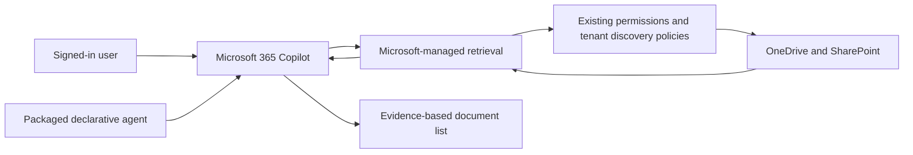

# Design and acceptance contract

Org Document Search specializes Microsoft 365 Copilot for organizational file discovery. The specification is a single native, unscoped `OneDriveAndSharePoint` capability, English/Hebrew guidance, grounded source results, original titles, constraint-aware selection, honest failure handling, and preservation of existing authorization. It adds no runtime service, index, application-wide file permissions, connector, or telemetry collector.



The manifest grants a retrieval capability, not additional file access. Prompt-injection instructions provide behavioral guidance; Microsoft authorization and tenant policies remain the security boundary. Broad source scope does not establish complete index coverage.

The intended behavior is:

```text
interpret original query and preserve explicit constraints
use native retrieval under the signed-in user's permissions
consider plausible English/Hebrew alternatives if supported
select and deduplicate returned evidence by relevance
present original titles and verified links/metadata
if no useful evidence, distinguish no matches from retrieval failure
never infer document nonexistence or fabricate execution traces
```

This is behavioral pseudocode, not a custom orchestrator. Microsoft determines actual searches and ranking. The source cannot enforce expanded query execution, tune a semantic index, guarantee metadata filters, or expose an exhaustive search log.

Authoring uses Toolkit's supported TypeSpec template format, reduced to instructions and one capability. TypeSpec emits agent JSON; local build utilities render publisher configuration, validate official schemas and stricter security invariants, and package four root files. The ZIP builder fixes timestamps and entry order. Vendored schema digests prevent accidental schema drift during offline CI.

Default builds use a fictional validation identity. Installing organizations supply persistent app identity and public publisher pages through ignored configuration. No tenant identifier or secret is needed in reusable source. The authenticated Toolkit lifecycle stages that organization's manifest before packaging and only publishes personally; organizational deployment remains an administrator action.

The SPARC phases were applied as discovery/specification, behavior and build pseudocode, native architecture selection, implementation/security refinement, and local acceptance checks. Ruflo tracked the hierarchical implementation, documentation, and evaluation work. Registry entries were paired with actual host sub-agents; ruflo registration alone was not treated as execution.

Acceptance has two independent parts. Local acceptance requires compilation, schema and configuration checks, meaningful negative tests, package inspection, icon checks, secret-pattern checks, and dependency audit. Production acceptance additionally requires the private real-document matrix, both cross-language directions, two-account permission isolation, sensitivity/prompt-injection checks, measured performance, licensing confirmation, and administrator approval. Synthetic scorer tests establish metric correctness only.
